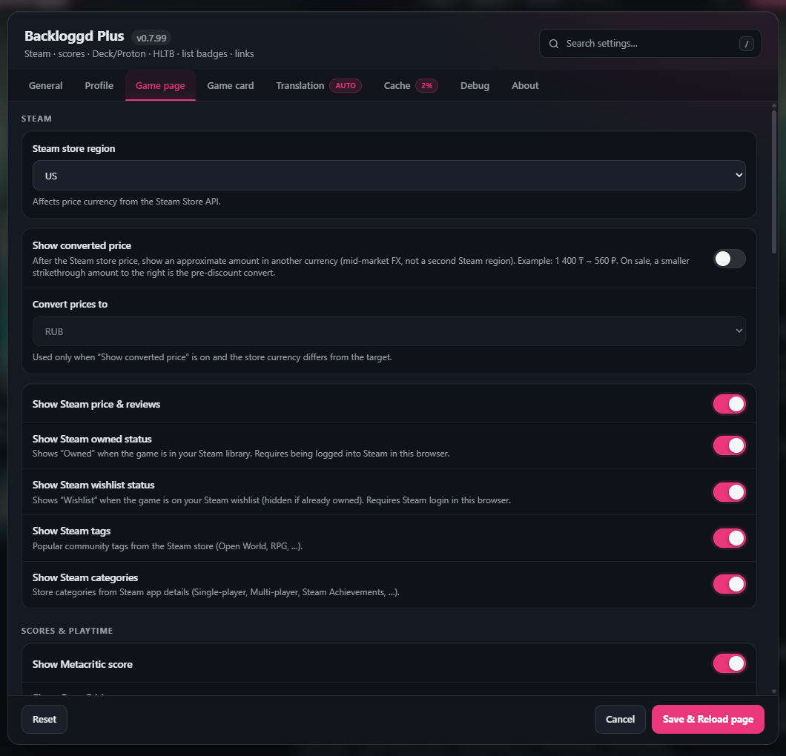
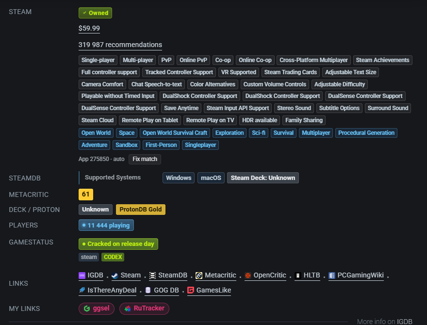
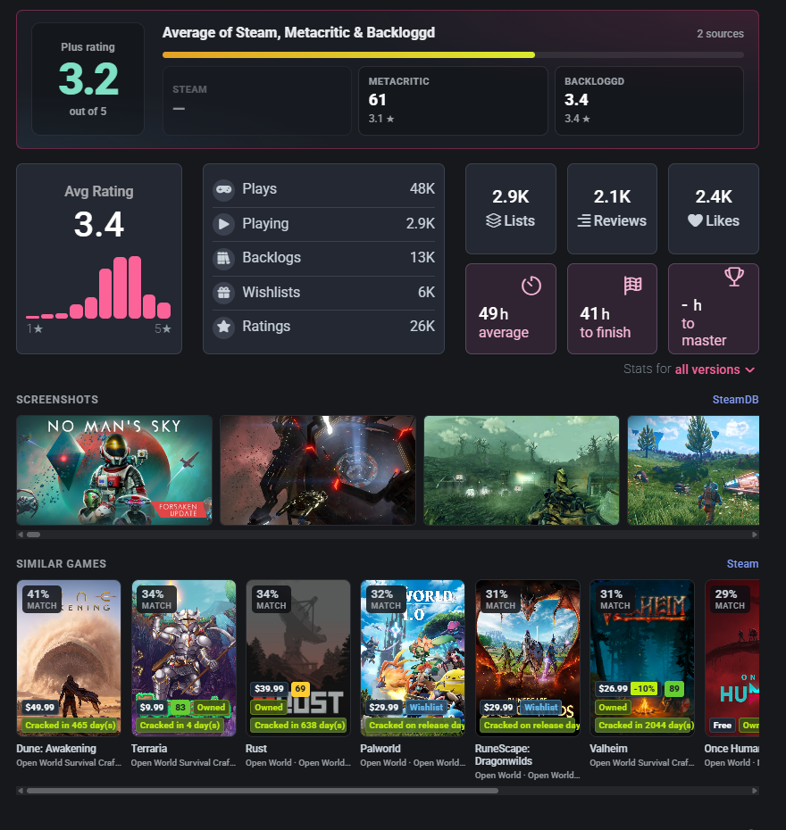
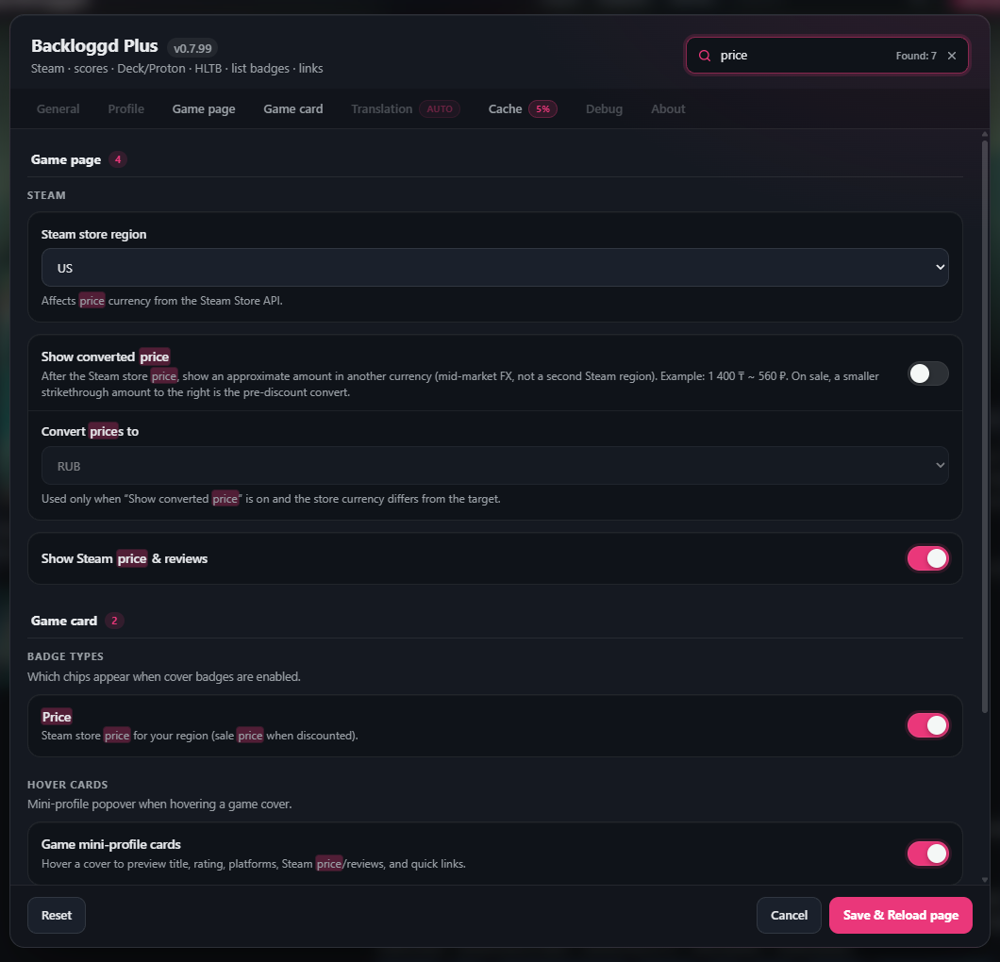
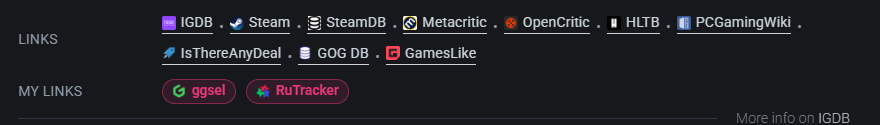

# Backloggd Plus

[English](README.md) · [Русский](README.ru.md) · [中文](README.zh.md) · [Español](README.es.md) · [Português](README.pt.md) · [Deutsch](README.de.md) · [Français](README.fr.md) · [日本語](README.ja.md) · [한국어](README.ko.md) · [Polski](README.pl.md)

[](https://github.com/NemoKing1210/backloggd-plus/actions/workflows/ci.yml)
[](https://raw.githubusercontent.com/NemoKing1210/backloggd-plus/main/backloggd-plus.user.js)
[](https://greasyfork.org/ru/scripts/587296-backloggd-plus)
[](https://scriptcat.org/ru/script-show-page/7077)
[](https://github.com/NemoKing1210/backloggd-plus/blob/main/LICENSE)
[](https://github.com/NemoKing1210/backloggd-plus/blob/main/CHANGELOG.md)

Un userscript qui enrichit [Backloggd](https://www.backloggd.com) avec des informations de jeu supplémentaires, une interface plus riche et des améliorations de confort — sans quitter le site.

Compatible avec [Tampermonkey](https://www.tampermonkey.net/), [Violentmonkey](https://violentmonkey.github.io/), [Greasemonkey](https://www.greasespot.net/), [ScriptCat](https://scriptcat.org/) et d'autres gestionnaires prenant en charge le bloc de métadonnées `// ==UserScript==`.

Également publié sur [Greasy Fork](https://greasyfork.org/ru/scripts/587296-backloggd-plus) et [ScriptCat](https://scriptcat.org/ru/script-show-page/7077).

> **Remarque :** les pages des catalogues Greasy Fork / ScriptCat peuvent être en retard sur ce dépôt — je n'arrive pas toujours à y publier chaque version tout de suite. Désolé. Pour la version la plus récente, préférez l'[URL d'installation raw GitHub](#installation-rapide) (ou clonez le dépôt et lancez `npm run build`). Les `@updateURL` / `@downloadURL` du script pointent aussi vers `main` sur GitHub.

> **Statut :** début (`0.7.101`). Enrichissement Backloggd + badges de listes + boutons Steam / SteamDB → Backloggd.

## Captures d'écran

Le userscript réel sur une page de jeu Backloggd en direct.



| | |
|---|---|
| <br>**Lignes de la page jeu** — Steam : possédé · prix · évaluations · tags et catégories, détails SteamDB, Metacritic, Deck/Proton, joueurs, GameStatus | <br>**Notes et extras** — moyenne de note Plus, galerie de captures Steam, jeux similaires avec badges sur les jaquettes |
| <br>**Recherche dans les réglages** — filtre tous les onglets d'un coup ; correspondances surlignées, résultats regroupés par onglet | <br>**Liens rapides** — sites intégrés plus vos propres modèles d'URL, en liens ou en boutons |

Également sur les pages de jeu : squelettes pendant le chargement, boutons de traduction, Fix match, ID du jeu, icône et jaquette SteamDB, export (Notion CSV / Markdown / JSON) et mini-profils au survol des jaquettes.

## Installation rapide

1. Installez un gestionnaire d'userscripts ([Tampermonkey](https://www.tampermonkey.net/), [Violentmonkey](https://violentmonkey.github.io/) ou [ScriptCat](https://scriptcat.org/) recommandés).
2. Installez depuis GitHub (URL raw ci-dessous), [Greasy Fork](https://greasyfork.org/ru/scripts/587296-backloggd-plus) ou [ScriptCat](https://scriptcat.org/ru/script-show-page/7077).

**URL d'installation (GitHub — la plus récente) :**

```
https://raw.githubusercontent.com/NemoKing1210/backloggd-plus/main/backloggd-plus.user.js
```

[](https://raw.githubusercontent.com/NemoKing1210/backloggd-plus/main/backloggd-plus.user.js)
[](https://greasyfork.org/ru/scripts/587296-backloggd-plus)
[](https://scriptcat.org/ru/script-show-page/7077)

### Installer par URL (tableau de bord du gestionnaire)

| Gestionnaire | Chemin |
|--------------|--------|
| Tampermonkey | Tableau de bord → **Utilities** → **Install from URL** |
| Violentmonkey | Tableau de bord → **+** → **Install from URL** |
| Greasemonkey | Menu de l'extension → **New User Script** → collez l'URL raw |
| ScriptCat | [Page du script](https://scriptcat.org/ru/script-show-page/7077) → **Установить скрипт**, ou installez l'[extension](https://scriptcat.org/) et utilisez l'URL raw GitHub |

Collez l'[URL d'installation GitHub](#installation-rapide) ci-dessus pour installer depuis le tableau de bord du gestionnaire. Installations par catalogue : [Greasy Fork](https://greasyfork.org/ru/scripts/587296-backloggd-plus) · [ScriptCat](https://scriptcat.org/ru/script-show-page/7077).

### Installation manuelle

1. Ouvrez le [`backloggd-plus.user.js`](https://github.com/NemoKing1210/backloggd-plus/blob/main/backloggd-plus.user.js) compilé dans ce dépôt (ou lancez `npm run build` après clonage).
2. Copiez tout le contenu du fichier.
3. Dans votre gestionnaire d'userscripts, créez un nouveau script et collez le code.
4. Enregistrez et activez le script.

## Mises à jour

Le script contient les métadonnées `@updateURL` et `@downloadURL` pointant vers le fichier raw GitHub. Les gestionnaires compatibles vérifient les mises à jour automatiquement.

Étapes de publication pour les mainteneurs : voir [DEVELOPMENT.md § Releases](https://github.com/NemoKing1210/backloggd-plus/blob/main/DEVELOPMENT.md#releases).

## Fonctionnalités

**Pages de jeu (`/games/{slug}/`) :**

- Lignes de détails natives sous Platforms — **Steam** (possédé · liste de souhaits · prix · fin de promo / minimum récent · évaluations · tags), **SteamDB** (franchise · systèmes pris en charge · technologies · dernière mise à jour de l'enregistrement), **Metacritic**, **OpenCritic**, **HLTB**, **Deck / Proton**, **Joueurs**, **GameStatus**, **Liens**
- **Fix match** — remplace le Steam App ID automatique quand la recherche du magasin se trompe (enregistré par slug) ; laissez l'App ID vide pour marquer un jeu comme absent de Steam
- Visuels SteamDB : icône de l'app avant le titre, logo sous **Change cover**, nombre de joueurs en ligne
- Ligne de détails SteamDB : franchise / OS depuis les API du magasin Steam ; technologies et dernière mise à jour de l'enregistrement depuis SteamDB quand il est accessible
- Bouton d'export sous l'en-tête Steam et dans l'éditeur de journal (optionnel ; Réglages → Page jeu ; Notion CSV / Markdown / JSON)
- ID de jeu Backloggd optionnel après le titre (Réglages → Page jeu ; cliquez pour copier)
- Boutons de traduction sur la description du jeu et les cartes d'avis (Réglages → Traduction ; Google Translate)
- En-tête / icône de communauté Steam sur les pages de jeu ; galerie de captures après les statistiques du jeu
- Jeux similaires sous les captures (Steam More Like This) avec % de correspondance des tags ; les cartes mènent à Backloggd et peuvent afficher les mêmes badges de jaquette que les grilles de listes
- Squelettes de chargement pendant l'arrivée de Steam / GameStatus / des notes
- Liens rapides avec favicons (IGDB, Steam, SteamDB, Metacritic, OpenCritic, HLTB, PCGamingWiki, IsThereAnyDeal, GOG DB, GamesLike) ; réordonnez-les par glisser-déposer et ajoutez vos propres liens depuis un modèle d'URL (`{title}` au format de votre choix, `{slug}`, `{appid}`, `{year}`, `{id}`) avec icône personnalisée optionnelle
- Badges Steam **Possédé** / **Wishlist** si vous êtes connecté à Steam dans le même navigateur (sans clé API)
- Badges de statut GameStatus sur les pages de jeu et les grilles de jaquettes
- Fonctionne sans clés API (endpoints publics du magasin Steam + userdata de session + API publiques GameStatus / HLTB / ProtonDB ; OpenCritic est trouvé via PCGamingWiki, clé RapidAPI personnelle optionnelle dans les Réglages)

**Listes / recherche / journal (grilles de jaquettes) :**

- Badges compacts sur les cartes `.game-cover` — prix, % d'avis Steam, Possédé, Wishlist, GameStatus (chargement paresseux dans le viewport ; interrupteurs par type dans Réglages → Fiche jeu)
- Mini-profil sur les jaquettes (survol par défaut ; ou clic droit / Shift + clic) — titre, note Backloggd, plateformes, prix/avis Steam, GameStatus, liens rapides ; le palier de la carte (Rookie → Legend) suit la note Backloggd (préchargement optionnel dans le viewport)
- Les mêmes badges / mini-profils sur les cartes de jeux similaires (bande de la page de jeu)

**Pages d'app Steam** (`store.steampowered.com/app/*`, `steamcommunity.com/app/*`) :

- Bouton avec icône Backloggd dans `.apphub_OtherSiteInfo` (même style que SteamDB / Community Hub)
- Lien construit depuis le slug de l'URL Steam ou le titre du jeu

**Pages d'app SteamDB** (`steamdb.info/app/*`) :

- Bouton Backloggd dans `nav.app-links` (même style `.btn` que Store / IGDB)
- Préfère le slug IGDB de la page quand il est disponible

**Réglages** (bouton **Plus** dans la navbar Backloggd / menu du gestionnaire d'userscripts) :

- Panneau à onglets : Général · Profil · Page jeu · Fiche jeu · Traduction · Cache · Débogage · À propos
- Recherche dans les réglages : tapez dans le champ (ou appuyez sur `/` / `Ctrl+K`) pour filtrer tous les onglets d'un coup — les correspondances dans les libellés et aides sont surlignées, les résultats sont regroupés par onglet, `Esc` efface
- Langue de l'interface (auto ou locale fixe)
- Profil : cartes mini-profil sur les avatars et pseudos (survol par défaut ; ou clic droit / Shift + clic ; préchargement optionnel dans le viewport) ; les jaquettes dans la carte (favoris / récents) ouvrent le mini-profil du jeu ; l'habillage de palier selon les jeux joués peut être désactivé ; habillage de la page de profil avec interrupteurs par bloc (en-tête, badge de palier, statistiques, navigation, favoris)
- Région du magasin Steam (devise des prix)
- Interrupteurs pour Steam / possédé / liste de souhaits / tags / Metacritic / OpenCritic / HLTB / Deck·Proton / GameStatus / joueurs / icône et logo SteamDB / galerie de captures / jeux similaires / bloc natif de statistiques / ID du jeu / traduction (description et avis) / badges de jaquette (par type) / mini-profils de jeux / liens / boutons Backloggd sur Steam et SteamDB
- Mode débogage : un panneau avec liens de source cliquables et dump complet des réponses
- Visibilité des liens par site (IGDB, Steam, SteamDB, Metacritic, OpenCritic, HLTB, PCGamingWiki, IsThereAnyDeal, GOG DB, GamesLike)
- Durée du cache + vider le cache (purge des entrées expirées + limite souple LRU ; bibliothèque et carte des tags avec TTL courts ; joueurs en ligne toujours en direct)

## Pages prises en charge

| Site | Modèle d'URL |
|------|--------------|
| Backloggd | `https://www.backloggd.com/*` |
| Backloggd (sans www) | `https://backloggd.com/*` |
| Steam Store (app) | `https://store.steampowered.com/app/*` |
| Steam Community (app) | `https://steamcommunity.com/app/*` |
| SteamDB (app) | `https://steamdb.info/app/*` |

## Développement et contribution

- [DEVELOPMENT.md](https://github.com/NemoKing1210/backloggd-plus/blob/main/DEVELOPMENT.md) — configuration locale, structure du dépôt, métadonnées, permissions, publications
- [CONTRIBUTING.md](https://github.com/NemoKing1210/backloggd-plus/blob/main/CONTRIBUTING.md) — règles de PR, conventions, localisation, contributeurs
- [AGENTS.md](https://github.com/NemoKing1210/backloggd-plus/blob/main/AGENTS.md) — notes d'architecture pour les agents IA
- [SECURITY.md](https://github.com/NemoKing1210/backloggd-plus/blob/main/SECURITY.md) — comment signaler une vulnérabilité en privé, périmètre et traitement de vos données par le script

```bash
npm install
npm run dev      # Serveur Vite — installez l'userscript généré avec le préfixe "dev:"
npm run build    # Production → dist/ + copie à la racine du dépôt
npm run ci       # Les mêmes vérifications que GitHub Actions
```

## Affiliation

Ce projet **n'est pas affilié** à Backloggd. C'est un userscript communautaire indépendant.

## Licence

[MIT](https://github.com/NemoKing1210/backloggd-plus/blob/main/LICENSE) — Copyright (c) 2026 NemoKing
